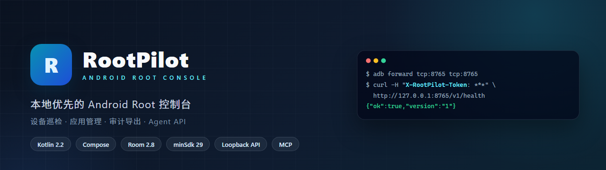
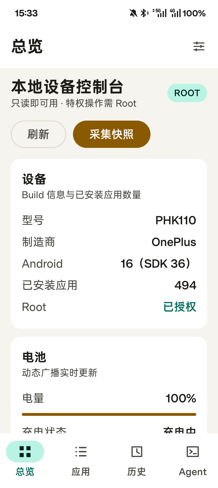
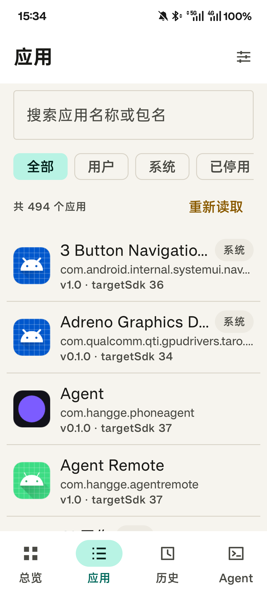
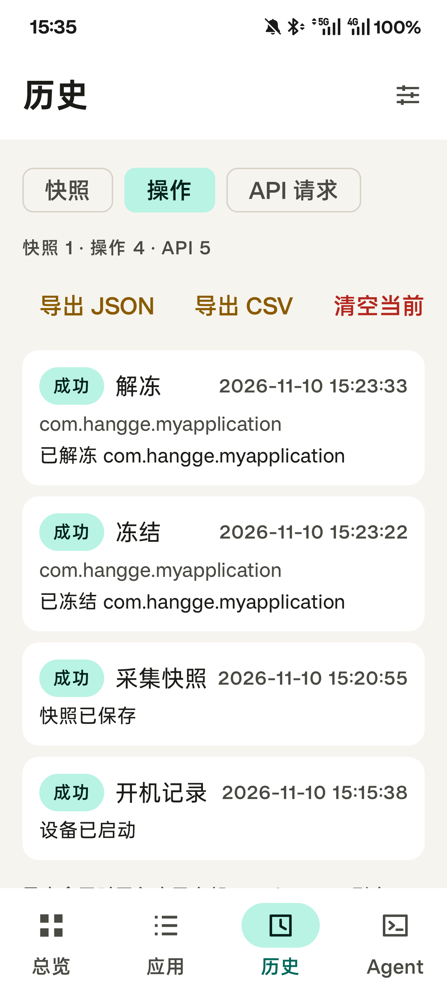
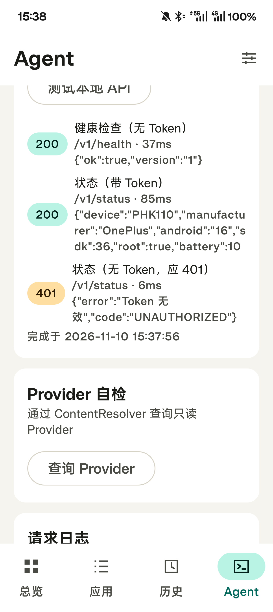
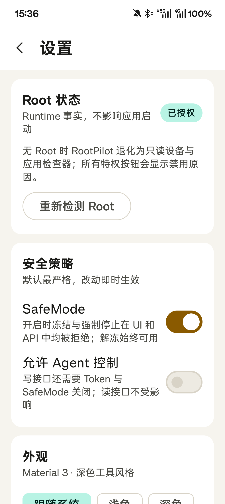
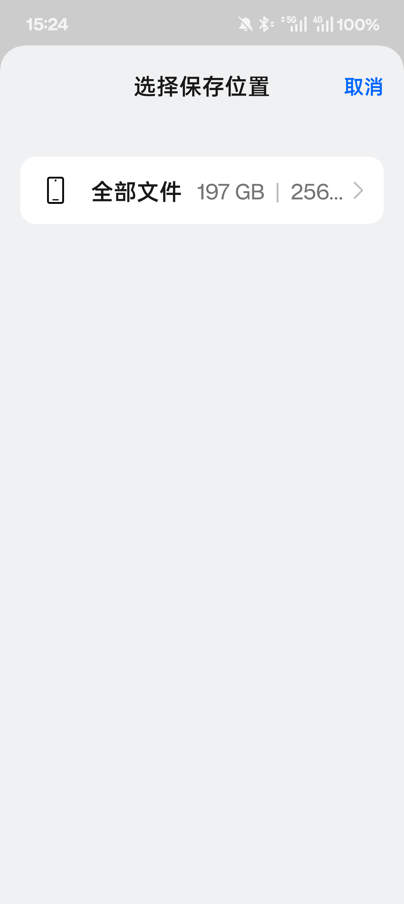

<p align="center">
  
</p>

<p align="center">
  
  
  
  
  
</p>

# RootPilot

本地优先的 Android Root 控制台（课程作业项目）。一个 `MainActivity`，Compose + Material 3，
四个底部标签（总览 / 应用 / 历史 / Agent），设置从顶栏进入。

## 界面预览

| 总览 | 应用 | 历史 |
|---|---|---|
|  |  |  |

| Agent | 设置 | 导出 |
|---|---|---|
|  |  |  |

## 状态

v1 功能已实现并在 PHK110 上手工验收：

- 总览（设备/Root/电池/内存存储/Agent/最近操作）、快照采集；
- 应用列表（494 个应用，搜索/筛选）、详情、权限、冻结/解冻/强制停止；
- Room 审计（快照、操作、API 请求），History 分类查看、JSON/CSV 导出（SAF + 内部副本）；
- 只读 ContentProvider + 应用内 Provider 自检；
- 前台 Agent 服务、回环 HTTP API、Token 鉴权、应用内自检（200/200/401）；
- 动态电池广播、静态开机广播（带 OEM 重放过滤）；
- SafeMode / 允许 Agent 控制 / 主题 / 解冻全部 / 清空历史。
- 通知监听、长轮询实时事件、连续定位/传感器订阅；
- 截图 + UIAutomator 层级的观察接口，以及执行后自动再次观察的操作闭环；
- 零依赖桌面 MCP Server，可让支持 MCP 的桌面 Agent 直接使用这些能力。
- 总览页“课程主线演示”：一键串联 Room + SharedPreferences + 内部文件、ContentProvider、
  前台 Service、Socket 与回环 HTTP，并生成不含 Token 的本地验证报告。

`assembleDebug`、`testDebugUnitTest`、`lintDebug` 均通过。仪器测试未运行（本机无 AVD，
PHK110 只做手工验收）。截图在 `docs/screenshots/`，验证记录见
[`docs/VERIFICATION.md`](docs/VERIFICATION.md)。

## 构建

```powershell
.\gradlew.bat :app:assembleDebug
.\gradlew.bat :app:testDebugUnitTest
.\gradlew.bat :app:lintDebug
```

APK：`app/build/outputs/apk/debug/app-debug.apk`

## 安装

```powershell
adb install -r app\build\outputs\apk\debug\app-debug.apk
```

仪器测试只在模拟器运行；PHK110 只做手工验收（Gradle 的 connected 任务会卸载应用并清空私有数据）。

## Agent API

1. 应用内 Agent 页启动服务（前台服务 + 常驻通知）。
2. 默认只绑定 `127.0.0.1`，默认端口 8765，Token 通过 `X-RootPilot-Token` 头传递。Agent 页的
   **允许局域网访问** 开关会让服务改绑 `0.0.0.0`，同一 Wi-Fi 的电脑可直连，无需 `adb forward`；
   **Token 校验** 开关可关闭校验（仅建议自家网络）。`/v1/status` 会返回当前 `lanIp` 与 `port`。
3. 桌面访问：

```powershell
adb forward tcp:8765 tcp:8765
curl http://127.0.0.1:8765/v1/health
curl -H "X-RootPilot-Token: <token>" http://127.0.0.1:8765/v1/status
```

Windows 也可以在项目根目录运行自动连接脚本，它会定位 ADB、选择已授权设备、建立转发并验证
`/v1/health`：

```powershell
.\scripts\connect-agent.ps1
```

如果连接了多台设备：

```powershell
.\scripts\connect-agent.ps1 -Device <设备序列号> -Port 8765
```

复制应用内 Token 后，可以使用桌面工具调用结构化能力：

```powershell
$env:ROOTPILOT_TOKEN = "<应用内复制的 Token>"
.\scripts\rootpilot-agent.ps1 capabilities
.\scripts\rootpilot-agent.ps1 network
.\scripts\rootpilot-agent.ps1 sensors
.\scripts\rootpilot-agent.ps1 launch -PackageName com.example.app
.\scripts\rootpilot-agent.ps1 tap -X 500 -Y 1200
.\scripts\rootpilot-agent.ps1 location
.\scripts\rootpilot-agent.ps1 sensor-sample -SensorType 1
.\scripts\rootpilot-agent.ps1 screenshot -OutputPath .\phone.png
.\scripts\rootpilot-agent.ps1 ui-tree -OutputPath .\phone-ui.xml
.\scripts\rootpilot-agent.ps1 files-write -InputPath .\note.txt -RemotePath inbox/note.txt
.\scripts\rootpilot-agent.ps1 files-read -RemotePath inbox/note.txt -OutputPath .\downloaded-note.txt
```

### 桌面 MCP Server

先建立 ADB 转发并设置应用内 Token：

```powershell
.\scripts\connect-agent.ps1
$env:ROOTPILOT_TOKEN = "<应用内复制的 Token>"
py -3 .\scripts\rootpilot_mcp.py
```

将 [`scripts/mcp-config.example.json`](scripts/mcp-config.example.json) 的命令和项目路径合并到桌面
Agent 的 MCP 配置即可。Server 通过标准输入/输出提供健康检查、设备状态、通知、事件、定位、
传感器、截图、组合观察、结构化操作和订阅工具；不会监听额外公网端口。

推荐自动操作循环：调用 `rootpilot_observe` 获取截图与 UI XML，基于控件 bounds 规划动作，调用
`rootpilot_act` 执行一次类型化动作；默认响应会在短暂等待后附带新的截图和 UI XML，供 Agent
验证界面是否达到预期。不要仅依赖固定坐标连续盲点。

健康检查是唯一免 Token 的接口。写接口需要 `Allow Agent Control` 打开，冻结/强制停止还要求
`SafeMode` 关闭。

## 安全边界

- 只有固定枚举的 Root 命令（`RootCommand`），包名经过正则校验，任何自由字符串都到不了 `su`。
- Provider 只读且 `exported=false`；外部集成只走回环 HTTP。
- Token 使用 Android Keystore 的 AES/GCM 加密后写入 SharedPreferences，不进入日志、Room、导出或界面。
- 位置、传感器和通知监听均为可见、可撤销的本机能力；没有云服务、分析或崩溃上报。

详见 [`docs/ARCHITECTURE.md`](docs/ARCHITECTURE.md)、[`docs/API.md`](docs/API.md)、
[`docs/DECISIONS.md`](docs/DECISIONS.md)。

## 贡献者

<a href="https://github.com/yhzhang-dev"></a>
&nbsp;&nbsp;
<a href="https://github.com/deepsea-whale"></a>
